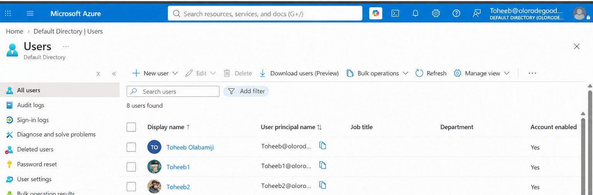
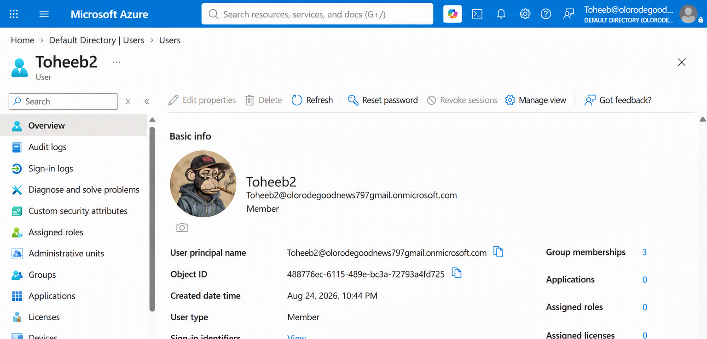
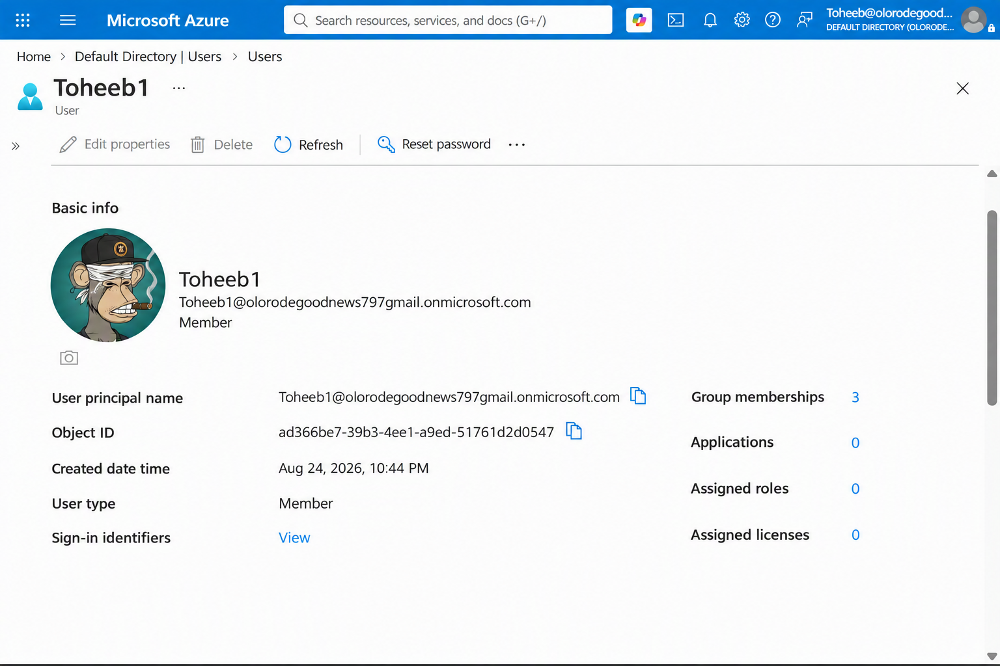
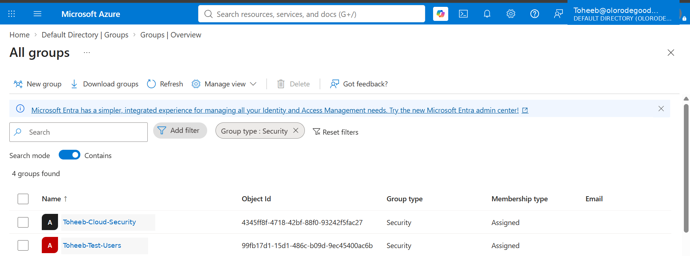
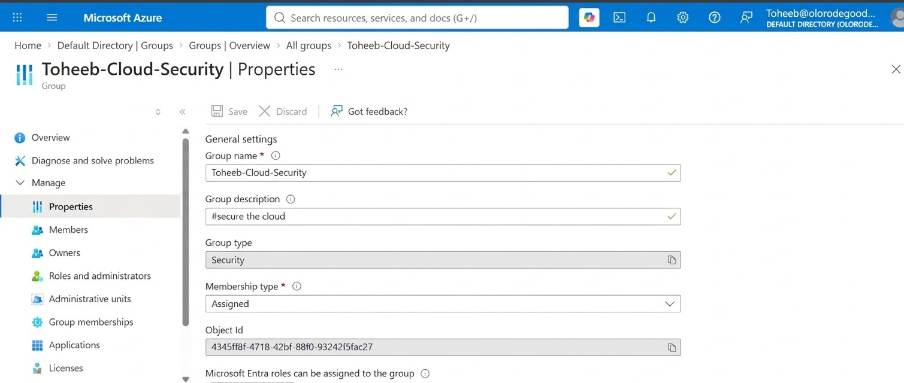
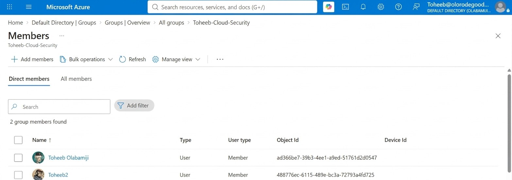
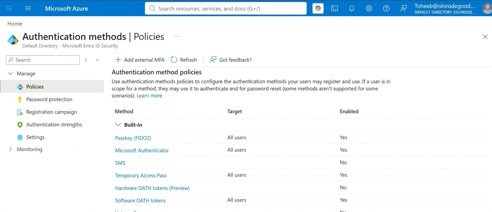
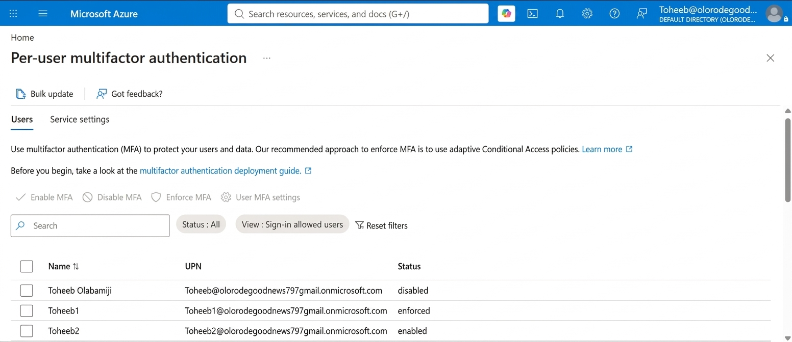
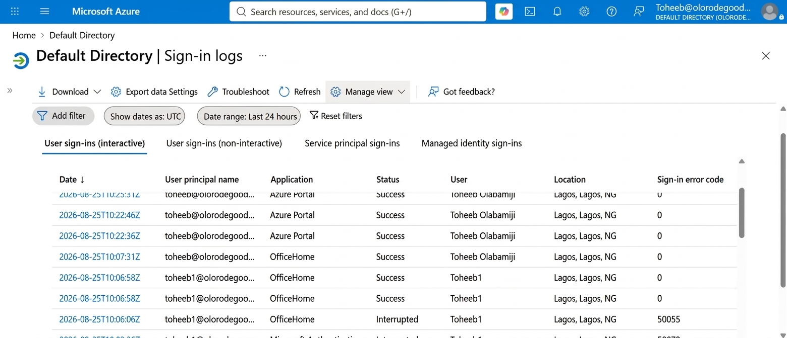

# Microsoft Entra ID Security Lab

## Project Overview

This project documents a hands-on Microsoft Entra ID security lab focused on identity and access management (IAM), authentication security, Multi-Factor Authentication (MFA), security groups, and sign-in investigation.

The lab was designed to explore how Microsoft Entra ID helps organizations manage user identities, secure authentication processes, and monitor account activity. Throughout the project, I created test users, configured security groups, reviewed authentication methods, implemented MFA, analyzed sign-in logs, and conducted a security assessment to identify potential risks and recommend improvements.

---

## Executive Summary

Identity is one of the most important security boundaries in modern cloud environments. A compromised user account can lead to unauthorized access, privilege escalation, data exposure, and service disruption.

This lab demonstrates practical identity security skills using Microsoft Entra ID. The project covers:

- User management
- Security group administration
- Authentication methods
- Multi-Factor Authentication (MFA)
- Sign-in log investigation
- Security assessment and recommendations

The primary finding from this lab was the importance of consistent MFA enforcement and proper access management through security groups.

---

## Skills Demonstrated

- Microsoft Entra ID Administration
- Identity and Access Management (IAM)
- User Lifecycle Management
- Security Group Administration
- Authentication Methods Management
- Multi-Factor Authentication (MFA)
- Sign-In Log Analysis
- Security Monitoring
- Access Control
- Principle of Least Privilege
- Security Assessment
- Cloud Security Fundamentals

---

## Technologies Used

| Technology | Purpose |
|------------|----------|
| Microsoft Entra ID | Identity and Access Management |
| Microsoft Entra Admin Center | Administration Portal |
| Microsoft Azure | Cloud Platform |
| Microsoft Authenticator | MFA Authentication |
| Security Groups | Access Management |
| Sign-In Logs | Monitoring and Investigation |
| Multi-Factor Authentication | Identity Protection |
| GitHub | Documentation and Version Control |

---

# Lab Objectives

The objectives of this lab were to:

- Create and manage users in Microsoft Entra ID.
- Compare account configurations.
- Create and manage security groups.
- Explore user authentication methods.
- Configure and evaluate MFA.
- Review sign-in activity.
- Investigate potential security risks.
- Apply identity security best practices.
- Document findings professionally using GitHub.

---

# Task 1: User Management

## Activities Performed

- Created two test users.
- Reviewed account information.
- Examined authorization details.
- Compared user configurations.

### Test Users

| User | User Principal Name |
|--------|--------------------|
| Toheeb1 | Toheeb1@olorodegoodnews797gmail.onmicrosoft.com |
| Toheeb2 | Toheeb2@olorodegoodnews797gmail.onmicrosoft.com |

### Findings

Both user accounts:

- Were successfully created.
- Had enabled account status.
- Had no certificate-based user ID configured.
- Were nearly identical except for their usernames and display names.

### What I Learned

Microsoft Entra ID provides centralized identity management capabilities that allow administrators to create, manage, monitor, and secure user accounts throughout their lifecycle.

### Security Relevance

User identities are commonly targeted by attackers. Effective account management reduces the risk of unauthorized access and identity compromise.

### Screenshots







---

# Task 2: Security Groups

## Activities Performed

Created two security groups:

| Security Group | Purpose |
|---------------|---------|
| Toheeb-Cloud-Security | Simulated cloud security team access management |
| Toheeb-Test-Users | Organized test user accounts |

Added users to appropriate groups and reviewed group membership.

## Key Concepts Learned

Security groups allow administrators to:

- Assign permissions efficiently.
- Manage multiple users collectively.
- Simplify access reviews.
- Reduce administrative effort.
- Improve security consistency.

## Why Security Groups Matter

Instead of configuring permissions individually, organizations can assign permissions to groups and manage membership centrally.

This approach improves:

- Scalability
- Consistency
- Security
- Auditability

### Security Relevance

Security groups support the Principle of Least Privilege by helping ensure users receive only the access required for their role.

### Screenshots







---

# Task 3: Authentication Methods

## Activities Performed

Explored available authentication methods including:

- Microsoft Authenticator
- SMS
- Temporary Access Pass (TAP)
- Passkeys (FIDO2)
- Hardware OATH Tokens
- Software OATH Tokens
- Email One-Time Passcodes
- Certificate-Based Authentication
- Verified ID

## Findings

Authentication methods are controlled through Entra ID authentication policies and user assignments.

Administrators can determine:

- Which authentication methods are available
- Which users can register them
- Which methods are preferred or restricted

## What I Learned

Strong authentication methods significantly improve the security of user accounts and reduce the risk of compromise from stolen credentials.

### Security Relevance

Modern organizations should move beyond password-only authentication whenever possible.

### Screenshots



---

# Task 4: Multi-Factor Authentication (MFA)

## Activities Performed

Reviewed MFA configuration for both test users.

| User | MFA Status |
|--------|-----------|
| Toheeb1 | Enforced |
| Toheeb2 | Enabled |

## Findings

The difference between "Enabled" and "Enforced" MFA became apparent during testing.

### Enabled

The user is expected to register MFA but may not have completed enrollment.

### Enforced

The user has completed registration and MFA is actively required during authentication.

## Security Scenario

Assume an attacker steals Toheeb1's password.

Without MFA:
- The attacker may gain access immediately.

With MFA:
- The attacker would still need the second authentication factor.

Examples include:

- Microsoft Authenticator approval
- SMS verification
- OATH token
- Passkey verification

### Security Relevance

MFA helps prevent:

- Password spraying
- Credential stuffing
- Password theft
- Unauthorized access

### Screenshots



---

# Task 5: Sign-In Investigation

## Activities Performed

Reviewed Microsoft Entra ID sign-in logs to understand how suspicious activity can be investigated.

## Investigation Areas

| Area | Purpose |
|--------|---------|
| Sign-In Status | Determine whether access succeeded |
| Error Code | Understand failures |
| Location | Detect unusual activity |
| Application | Identify targeted resources |
| Authentication Details | Review MFA activity |
| Date and Time | Build an investigation timeline |

## What I Learned

Sign-in logs are valuable sources of evidence during security investigations and incident response activities.

### Security Relevance

Sign-in monitoring helps detect:

- Unauthorized access attempts
- Suspicious locations
- Failed authentication attempts
- Potential account compromise

### Screenshots



---

# Task 6: Security Assessment

## Finding 1: Inconsistent MFA Enforcement

### Risk

Different accounts received different levels of authentication protection.

### Recommendation

Ensure MFA is fully registered and enforced for all accounts requiring enhanced security.

---

## Finding 2: Authentication Method Management

### Risk

Users may rely on weaker authentication methods.

### Recommendation

Prioritize stronger authentication methods such as:

- Microsoft Authenticator
- Passkeys (FIDO2)
- Phishing-resistant authentication

---

## Finding 3: Group-Based Access Management

### Risk

Individual permission assignments become difficult to maintain.

### Recommendation

Use security groups consistently to manage access through role-based assignments.

---

# Security Recommendations

Based on findings from this lab:

1. Enforce MFA consistently.
2. Prefer phishing-resistant authentication methods.
3. Review group memberships regularly.
4. Monitor sign-in activity frequently.
5. Apply the Principle of Least Privilege.
6. Remove inactive accounts promptly.
7. Standardize identity and authentication policies.

---

# Key Lessons Learned

- Identity security is critical in cloud environments.
- Security groups improve access management efficiency.
- MFA significantly reduces account compromise risk.
- Authentication methods should be carefully managed.
- Sign-in logs support effective investigations.
- Small configuration differences can create security gaps.
- Continuous monitoring is essential for identity security.

---

# Conclusion

This project provided practical experience with Microsoft Entra ID identity and security capabilities.

The lab demonstrated how administrators can manage users, organize security groups, implement MFA, review authentication methods, investigate sign-in activity, and assess identity-related risks.

The most significant finding was that security controls must be consistently applied across accounts. Even small differences in configuration, such as MFA status, can introduce unnecessary risk.

Overall, this labntra-id-security-lab/

├── README.md

├── Screenshots/
│   ├── Screenshots1.png
│   ├── Screenshots1a.png
│   ├── Screenshots1b.png
│   ├── Screenshots2.png
│   ├── Screenshots3-auth-meth-policy.png
│   ├── Screenshots4-mfa.png
│   └── Screenshots5-signin.png
```

---

## Author

**Toheeb Olabamiji**

Aspiring Cloud Engineer | Cybersecurity Enthusiast

### Connect With Me

- LinkedIn: www.linkedin.com/in/toheeb-olabamiji-b92337265
- GitHub: https://github.com/Beehot07
